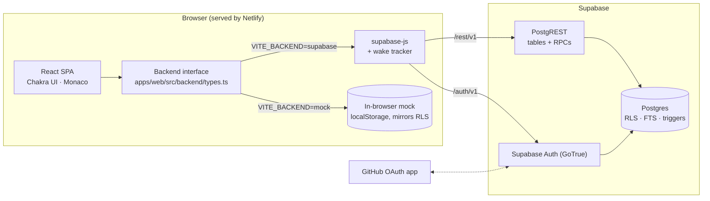

# CodeSnip

[](https://github.com/temitopeagbola/CodeSnip/actions/workflows/ci.yml)

A code snippet manager for developers: save the snippets you keep rewriting, find
them again with full-text search and tags, and share the good ones with a link.

Production URL: https://codesnip.temitopeagbola.com (Netlify, deployed from `main`).

## Overview

Developers end up with useful snippets scattered across gists, notes and old
projects. CodeSnip keeps them in one library: each snippet has a title,
description, language, tags and code, edited in the Monaco editor. Snippets are
private by default; making one public gives it a share link that works without
an account. The React single-page app talks directly to Supabase: GoTrue
handles sign-in, PostgREST serves the data, and Postgres row level security
(RLS) decides who can read and write every row. There is no custom API server.

## Key features

- **Sign-in**: email and password, GitHub OAuth (shown only when the provider is enabled on the auth server), and a one-click **Try the demo** button that signs into a shared demo account.
- **Snippets**: create, edit and delete snippets with title, description, language (31 options), up to 10 tags and public/private visibility.
- **Monaco editor**: bundled locally (no CDN) and lazy-loaded, follows light/dark mode, <kbd>Ctrl/⌘</kbd>+<kbd>S</kbd> saves, with a plain-textarea fallback if the editor fails to load.
- **Search and filters**: Postgres full-text search with prefix matching ("debou" finds `useDebounce`), camelCase splitting and weighted ranking (title > description and tags > language > code), plus tag and language filters with counts. Search text and filters live in the URL.
- **Sharing**: public snippets get a `/s/:id` page that works signed out and appear on the **Explore** page. Signed-in users can **Save a copy** of someone else's public snippet.
- **Copy to clipboard** from library cards, the editor and share pages.
- **Import / export JSON**: export your whole library; import a CodeSnip export or any JSON array of `{ title, code, ... }`. Invalid entries are skipped and reported, fixable ones (unknown language, invalid tags) are repaired with a warning, and imports are private unless you opt to keep the file's visibility.
- **States and UX**: loading skeletons, empty and error states with retry, a "Waking up the server…" banner when a request takes over 2.5 s, an unsaved-changes guard, dark mode, a skip link and a layout that works down to 375px.
- **Offline demo mode**: with no Supabase configured, the app runs on an in-browser backend (localStorage) and says so in a banner.

## Tech stack

| Layer          | Choice                                                                                                                   |
| -------------- | ------------------------------------------------------------------------------------------------------------------------ |
| Frontend       | React 19, TypeScript (strict), Vite 8, Chakra UI 3, Monaco (`@monaco-editor/react`), TanStack Query, React Router 7, zod |
| Auth           | Supabase Auth (GoTrue): email/password and GitHub OAuth                                                                  |
| Database / API | Supabase Postgres 17 with RLS, column grants, triggers and full-text search, exposed through PostgREST                   |
| Testing        | Vitest + Testing Library (unit/integration), Vitest + `pg` (database/RLS), Playwright (end-to-end)                       |
| Tooling        | npm workspaces, ESLint, Prettier, Docker Compose, GitHub Actions                                                         |
| Hosting        | Netlify (static SPA) and a Supabase project                                                                              |

## Architecture



- **The database is the API.** PostgREST exposes the `public` schema. RLS
  policies, column grants, check constraints and triggers do the authorization
  and validation. The `search_snippets` and `snippet_facets` RPCs are
  `security invoker`, so they never see more than a direct table read would.
- **Defense in depth.** `owner_id` defaults to `auth.uid()` and can't be
  written through the API (column grants), and RLS `with check` also requires
  it to be the caller. `created_at`, `updated_at` and `search_vector` are
  server-managed. A profile is readable only by its owner, or by anyone once
  that user has a public snippet.
- **One interface, two backends.** The UI only uses the `Backend` interface.
  The Supabase implementation is used in production; the mock implements the
  same rules on `localStorage` for development, tests and an unconfigured
  deploy. A database test keeps the mock's demo data identical to `seed.sql`.
- **Waking server.** A fetch wrapper tracks in-flight requests. After 2.5 s it
  shows a banner that the backend is waking up; after 15 s it says the
  project may be paused.

### Data model

| Table       | Purpose                                                                                 | Who can read                                        | Who can write                             |
| ----------- | --------------------------------------------------------------------------------------- | --------------------------------------------------- | ----------------------------------------- |
| `snippets`  | title, description, code, language, tags[], visibility, timestamps, weighted `tsvector` | public rows: anyone; private rows: owner            | owner only (insert/update/delete)         |
| `profiles`  | display name, avatar, `is_demo`; created by a trigger on sign-up                        | owner, or anyone once the user has a public snippet | owner (`display_name`, `avatar_url` only) |
| `languages` | lookup table of Monaco language ids, foreign key target for `snippets.language`         | anyone                                              | nobody (migrations only)                  |

Other database rules: tags are trimmed, lowercased and de-duplicated by a
trigger; each account can hold up to 2,000 snippets; and the shared demo
account's password and email can't be changed.

## Project structure

```
apps/web/            React SPA (Vite)
  src/backend/       Backend interface, Supabase and mock implementations, generated DB types
  src/lib/           Pure logic: validation, tags, import/export, wake tracker, text search
  src/pages/         Route pages (landing, login, library, editor, explore, share, auth callback)
  src/components/    UI components
  e2e/               Playwright tests
  Dockerfile         Production image (nginx serving the build)
supabase/
  migrations/        Schema, RLS policies, triggers, search RPCs
  seed.sql           Demo data (idempotent)
  tests/             Database and RLS tests (Vitest + pg)
  config.toml        Supabase CLI config
docker/              Local API gateway (nginx) config and the migration runner
docs/PLAN.md         Original build plan
scripts/             generate-keys.mjs: anon/service keys for a JWT secret
.github/workflows/   CI and the nightly demo reset
docker-compose.yml   Local Supabase stack + web app
netlify.toml         Netlify build, redirects and headers
```

## Getting started

### Prerequisites

- **Node.js 22 or newer** (`engines` in `package.json`; CI and Netlify use Node 22) and npm.
- **Docker with Compose v2** for the local Supabase stack and the database tests. Not needed for offline demo mode.

### Install

```bash
git clone https://github.com/temitopeagbola/CodeSnip.git
cd CodeSnip
npm ci
```

### Environment

```bash
cp .env.example .env
```

The root `.env` is read by Vite and Docker Compose. The test variables
(`DATABASE_URL`, `E2E_*`, `PLAYWRIGHT_CHROMIUM_PATH`) are read from your shell
environment, and every one has a working local default. Every variable is
documented in [`.env.example`](.env.example), and its defaults point at the
local stack. Variables starting with `VITE_` are baked into the browser bundle,
so never put a secret in one.

| Variable                                                           | Used by           | Purpose                                                                          |
| ------------------------------------------------------------------ | ----------------- | -------------------------------------------------------------------------------- |
| `VITE_BACKEND`                                                     | web               | `supabase` or `mock`; empty means supabase when URL and key are set, else mock   |
| `VITE_SUPABASE_URL`                                                | web               | Supabase project (or local gateway) URL                                          |
| `VITE_SUPABASE_ANON_KEY`                                           | web               | Supabase anon or publishable key (public by design; RLS protects the data)       |
| `VITE_DEMO_EMAIL`, `VITE_DEMO_PASSWORD`                            | web               | Shared demo account used by **Try the demo** (must match `supabase/seed.sql`)    |
| `VITE_MOCK_LATENCY_MS`                                             | web (mock)        | Artificial latency per mock call                                                 |
| `POSTGRES_PASSWORD`, `JWT_SECRET`, `ANON_KEY`                      | Docker Compose    | Local stack credentials (development only)                                       |
| `API_EXTERNAL_URL`, `SITE_URL`, `ADDITIONAL_REDIRECT_URLS`         | Docker Compose    | Local auth URLs and allowed redirects                                            |
| `API_PORT`, `DB_PORT`, `WEB_PORT`                                  | Docker Compose    | Host ports for the API gateway, Postgres and the web container                   |
| `SEED`                                                             | Docker Compose    | Run `supabase/seed.sql` after migrations                                         |
| `GITHUB_OAUTH_ENABLED`, `GITHUB_CLIENT_ID`, `GITHUB_CLIENT_SECRET` | Docker Compose    | Optional GitHub OAuth for the local stack                                        |
| `DATABASE_URL`                                                     | `npm run test:db` | Postgres connection for the database tests                                       |
| `E2E_BACKEND`, `E2E_BASE_URL`, `PLAYWRIGHT_CHROMIUM_PATH`          | Playwright        | Which backend to build against, an existing URL to test, a preinstalled Chromium |

### Run it

Pick one:

```bash
# A. Vite dev server + local Supabase (Postgres, GoTrue, PostgREST, gateway)
npm run db:up       # starts the stack, applies migrations, seeds demo data
npm run dev         # http://localhost:5173

# B. No backend: in-browser mock, data stays in localStorage
npm run dev:mock    # http://localhost:5173

# C. Everything in Docker, including a production build of the web app
docker compose up --build   # web http://localhost:3000
```

The local stack serves the API at `http://localhost:54321` and Postgres at
`localhost:54322`. These are the same ports and keys as `npx supabase start`,
which also works with [`supabase/config.toml`](supabase/config.toml).

Demo login: `demo@codesnip.dev` / `codesnip-demo`, or click **Try the demo**.

## Scripts

Run from the repo root.

| Command                | What it does                                                              |
| ---------------------- | ------------------------------------------------------------------------- |
| `npm run dev`          | Vite dev server (port 5173)                                               |
| `npm run dev:mock`     | Vite dev server with the in-browser mock backend                          |
| `npm run build`        | Typecheck and build the web app to `apps/web/dist`                        |
| `npm run lint`         | ESLint                                                                    |
| `npm run format:check` | Prettier check (`npm run format` to fix)                                  |
| `npm run typecheck`    | TypeScript for the web app and the database tests                         |
| `npm test`             | Unit and integration tests                                                |
| `npm run test:db`      | Database and RLS tests (needs the local stack)                            |
| `npm run test:e2e`     | Playwright end-to-end tests against a mock-backend build                  |
| `npm run db:up`        | Start the local Supabase stack, apply migrations and seed                 |
| `npm run db:seed`      | Apply any new migrations and reset the demo data                          |
| `npm run db:reset`     | Delete the local database volume and start fresh                          |
| `npm run db:types`     | Regenerate `apps/web/src/backend/database.types.ts` from the local schema |

## Testing

```bash
npm test                                      # unit + integration (Vitest, jsdom)

npm run db:up                                 # local Supabase stack
npm run test:db                               # database / RLS tests

npx playwright install chromium               # once, run in apps/web
npm run test:e2e                              # e2e against the mock backend
npm run test:e2e:supabase -w @codesnip/web    # e2e against the local Supabase stack
```

- **Unit and integration tests** (`apps/web/src/**/*.test.ts(x)`) cover validation,
  tags, import/export planning, the wake tracker, clipboard fallbacks, error and
  row mapping, the mock backend's RLS rules, and the real app rendered with its
  routes and providers.
- **Database tests** ([`supabase/tests`](supabase/tests)) run each case in a
  rolled-back transaction and switch roles the way PostgREST does (`SET ROLE`
  plus `request.jwt.claims`). They cover RLS for anonymous, owner and
  other-user access, column grants, triggers, constraints, the quota, search
  ranking and injection-safe search input, facets, and parity between the mock
  data and `seed.sql`.
- **End-to-end tests** ([`apps/web/e2e`](apps/web/e2e)) cover the main flow
  (demo login, search, tag filter, create in Monaco, save, copy, make public,
  copy the link, sign out, open the share link anonymously, confirm a private
  link is hidden, delete), a JSON export/import round trip and a 375px layout
  check. Playwright builds and serves the app itself.

CI ([`.github/workflows/ci.yml`](.github/workflows/ci.yml)) runs on every push and
pull request: format, lint, typecheck, unit tests and build; e2e on the mock
backend; the local Supabase stack with the database tests and e2e; and
`docker compose build`.

## Deployment

The web app is a static SPA on **Netlify**; the backend is a **Supabase**
project. There is no server component to host.

### Supabase

1. Create a Supabase project.
2. Apply the migrations and seed (needs a Supabase account):
   ```bash
   npx supabase login
   npx supabase link --project-ref <project-ref>
   npx supabase db push --include-seed
   ```
3. Under **Authentication > URL Configuration**, set the Site URL to the
   production URL and allow redirects to `<production-url>/**` (plus Netlify
   deploy-preview URLs if you use them).
4. Optional GitHub sign-in: create a GitHub OAuth app with callback URL
   `https://<project-ref>.supabase.co/auth/v1/callback` and enable the GitHub
   provider with its client ID and secret.
5. Copy the project URL and the anon (or publishable) key for Netlify.

### Netlify

[`netlify.toml`](netlify.toml) builds `apps/web` (`npm run build`, publish
`dist`, Node 22), adds the SPA fallback, security headers including a CSP, and
long-lived caching for hashed assets. Set `VITE_SUPABASE_URL` and
`VITE_SUPABASE_ANON_KEY` (and optionally `VITE_BACKEND=supabase`) in the site's
environment variables. Without them the deployed site runs in offline demo
mode. Merges to `main` deploy to production.

### Nightly demo reset

[`reset-demo.yml`](.github/workflows/reset-demo.yml) re-runs the idempotent
`supabase/seed.sql` against production every night, so the shared demo account
starts clean. It needs the repository secret `SUPABASE_DB_URL` (a Postgres
connection string for the Supabase project) and skips itself without it.

## Contributing

There is no `CONTRIBUTING.md`. The flow is:

1. Branch from `main`.
2. Make your change and run `npm run format:check`, `npm run lint`,
   `npm run typecheck`, `npm test` and `npm run build`; also run
   `npm run test:db` and the e2e tests if you touched the database or a user flow.
3. Open a pull request. CI must pass before merging. Merging to `main` deploys
   to production.

## Known limitations

- The demo account is shared and its password is public. A trigger blocks
  password and email changes, and the nightly workflow resets its snippets.
  Anything published from it is visible on Explore until the reset.
- Explore has no moderation, and PostgREST itself isn't rate limited. Limits in
  place: field size checks, 10 tags per snippet, 2,000 snippets per account and
  Supabase Auth's built-in rate limits.
- Search is Postgres full-text search with prefix matching and a title
  substring fallback, not fuzzy search.
- The mock backend keeps everything in the browser's localStorage (passwords
  are hashed). It is for development, tests and unconfigured deploys only.

## License

All rights reserved.
